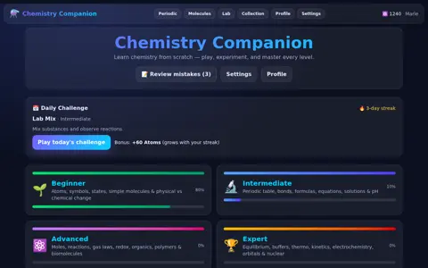
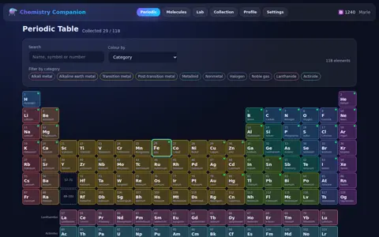
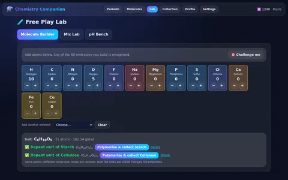
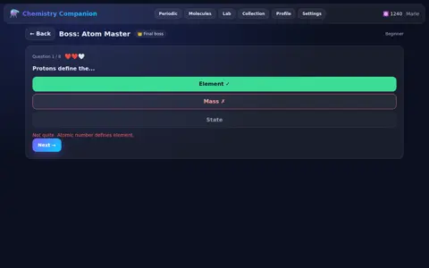
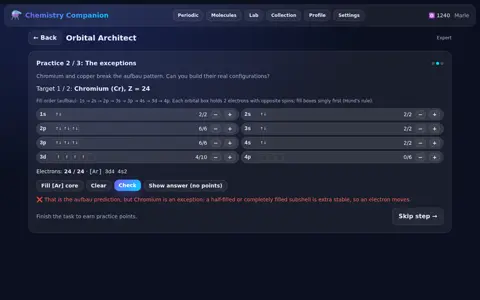
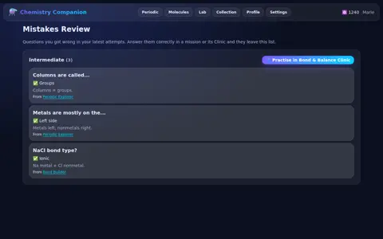

# Chemistry Companion

An interactive web game that teaches chemistry from scratch, across four worlds (Beginner, Intermediate,
Advanced, Expert). Built with TypeScript, React 19, Vite, Tailwind CSS, Framer Motion and Zustand.

- **118 elements**: complete periodic table with IUPAC atomic weights, electron configurations,
  electronegativity, uses and fun facts.
- **60 molecules**: 20 common compounds, 16 organic molecules, 10 polymers and 14 biomolecules.
- **40 missions**: 10 per world, each with 7 core missions, a timed mini-boss, a multi-stage final boss with
  lives, and a Clinic that re-teaches the questions you missed.

## Demo

- ▶ **Demo video** (~90 s, captioned): [`public/media/demo.mp4`](public/media/demo.mp4) ·
  [WebM](public/media/demo.webm) · [captions](public/media/demo.vtt)
- 🖼 **Photo gallery**: [`public/media/gallery/`](public/media/gallery/)
- In the app: the home page's **See it in action** card opens **/showcase** (video with chapters + gallery).

| | | |
|---|---|---|
|  |  |  |
|  |  |  |

See [FEATURES.md](./FEATURES.md) for a summary of every feature and how to test it.

## Quick start

Requires Node.js 22.12 or newer.

```bash
npm install
npm run dev
```

Open http://localhost:5173.

## What you can do

| Area | Highlights |
|---|---|
| **Missions** | Intro → graded practice steps → quiz → results. 24 kinds of interactive practice: atom builder, symbol match, sorters, molecule maker, periodic-table clue hunts, bond prediction, equation balancing, lab reactions, pH, moles, reaction types, gas laws, functional groups, oxidation states, Le Chatelier, ΔG, rate laws, galvanic cells, half-lives, atom counting, polymers, buffers and electron configurations. |
| **Bosses** | Mini-bosses have a quiz timer; final bosses have several stages and 3 lives. A mini-boss opens after 3 core missions; the final boss after the mini-boss. |
| **Clinics** | Each world's Clinic builds a quiz from the questions you got wrong, shows where each came from, and clears them once you answer correctly. The world map marks a Clinic as *Recommended* when it can help. |
| **Progress** | Stars from accuracy (quiz + practice), Atoms from score improvements, one-time rewards on the first clear. Completing 80 % of a world unlocks the next. Every element and molecule is the reward of exactly one mission. |
| **Periodic table** | 18-column layout with lanthanide/actinide rows; colour by category, block, state or electronegativity/mass trends; search, filters, arrow-key navigation; free *Collect* button. |
| **Lab** | Molecule Builder recognises all 60 molecules (and polymer repeat units) with hints and challenges; Mix bench with 19 balanced reactions (some need heat, a catalyst or yeast); pH bench. |
| **Collection / Molecules** | Collection progress (118 elements, 60 molecules, badges) with locked slots; a browsable molecule explorer with molar masses, composition and "build it / make it" links. |
| **Daily Challenge** | One mission per day (from your unlocked worlds) pays bonus Atoms that grow with your day streak, even on replays. |
| **Mistakes Review** | Every question you missed, across all worlds, with the right answer, the explanation and a link to the Clinic. |
| **Kid mode** | Quiz hints that remove a wrong answer, an extra life for bosses, 50 % more time for mini-bosses, friendlier messages. |
| **Showcase** | `/showcase`: the demo video (captions, clickable chapters) and a screenshot gallery with a keyboard-friendly lightbox. Regenerate the media with `node scripts/capture-media.mjs`. |
| **Settings** | Dark, light and high-contrast themes; text size; reduced motion (also follows the OS setting); kid mode; sound effects. Progress is saved in `localStorage` and can be exported/imported as JSON; old saves are upgraded automatically. |

## Scripts

| Command | Purpose |
|---|---|
| `npm run dev` | Start the dev server |
| `npm run build` | Type-check and build for production |
| `npm run preview` | Preview the production build |
| `npm test` | Unit and component tests (Vitest, jsdom) |
| `npm run test:coverage` | Tests with coverage (thresholds enforced) |
| `npm run test:stress` | Tests repeated under simulated slow-machine load, to catch timing-sensitive failures |
| `npm run typecheck` / `npm run typecheck:tests` | TypeScript check of the app / app + tests |
| `npm run lint` | oxlint |
| `npm run check` | Everything above in one go (what CI runs) |
| `npm run test:e2e` | Playwright end-to-end tests, including axe WCAG 2.1 AA scans |
| `npm run test:e2e:sandbox` | End-to-end tests with a sandbox-provided Chromium (see below) |

## End-to-end tests

```bash
npx playwright install chromium
npm run test:e2e
```

If the Playwright browser download is blocked (CI sandboxes, proxies), point the tests at any installed Chromium:

```bash
PLAYWRIGHT_CHROMIUM_EXECUTABLE=/path/to/chromium npm run test:e2e
```

In a sandbox with no browser at all, use the helper script. It reuses `/tmp/chromium` if present; otherwise it
fetches a headless Chromium from the npm registry (`@sparticuz/chromium`, outside this project's dependencies),
unpacks it to `/tmp/chromium`, and runs Playwright with it. Extra arguments go straight to `playwright test`:

```bash
./scripts/e2e-sandbox.sh                        # or: npm run test:e2e:sandbox
./scripts/e2e-sandbox.sh tests/e2e/lab.spec.ts   # single spec
./scripts/e2e-sandbox.sh --repeat-each=3         # flakiness check
```

## Continuous integration

`.github/workflows/ci.yml` runs `npm run check` and the Playwright suite on pushes and pull requests.

## Adding content

Content lives in `src/data/` and is validated by `tests/data-integrity.test.ts`:

- **Missions** (`missions.ts`): a step's `data` is type-checked against its `interactive` kind
  (`src/types/interactives.ts`). The tests check, among other things, that quiz answers are among the options,
  displayed equations balance, pH targets are reachable, each world keeps 7 core + mini-boss + boss + Clinic,
  and every element and molecule remains the reward of exactly one mission.
- **Elements / molecules / reactions**: tests cross-check electron configurations against an aufbau
  implementation, molecule atom lists against formulas and reference molar masses, and reaction balance.

## Documentation

- [ARCHITECTURE.md](./ARCHITECTURE.md): layers, content model, engine modules, runtime flow, testing.
- [ROADMAP.md](./ROADMAP.md): what was built in each phase and what is proposed next.
- [FEATURES.md](./FEATURES.md): feature summary and how to test each feature.

## Accessibility

Targets WCAG 2.1 AA: keyboard navigation throughout (including the periodic table), a skip link, per-page titles,
focus management on navigation, visible focus, labelled controls and live feedback, three themes with checked
contrast, text size and reduced-motion settings. The e2e suite runs axe on every page and key mission states in
all three themes.

## License

MIT
